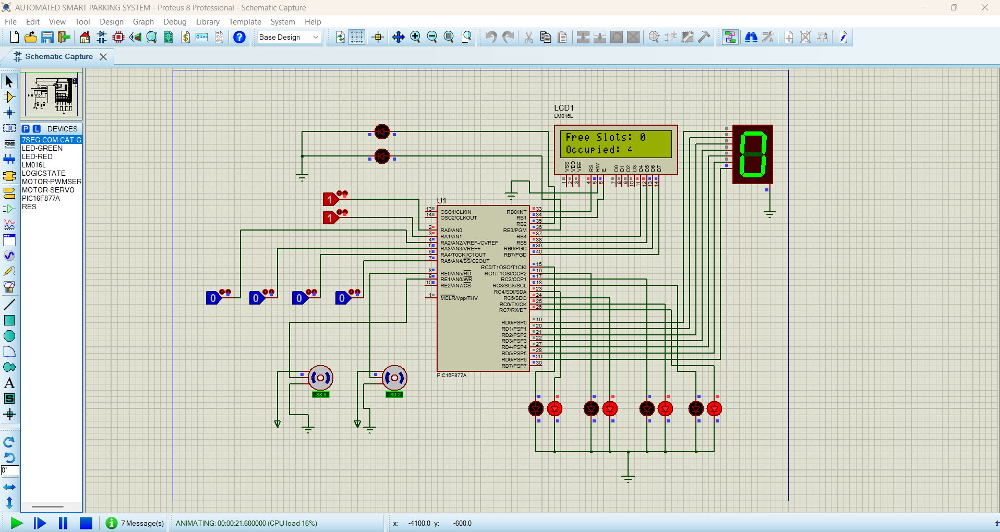
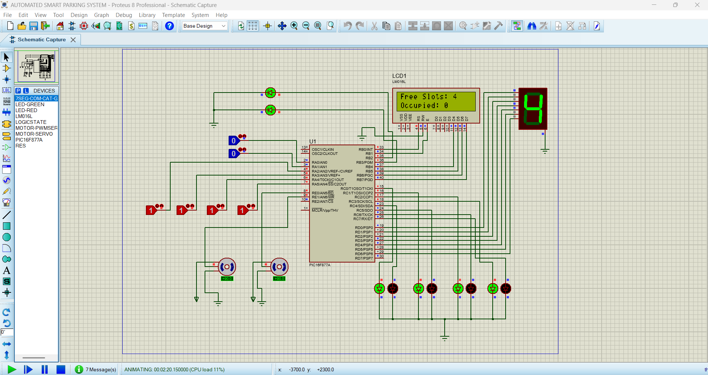

# Automated Parking System Using PIC16F877A

A Proteus-simulated automated parking system using the PIC16F877A, MPLAB
HI-TECH C, a 16×2 LCD in **4-bit mode**, six simulated sensor inputs,
parking-slot LEDs, and servo-operated entry/exit gates.

## Features

-   Monitors four parking slots.
-   Displays free and occupied slot counts on a 16×2 LCD.
-   Four green LEDs indicate free slots; four red LEDs indicate occupied
    slots.
-   Entry gate opens when an entry vehicle is detected and at least one
    slot is free.
-   Exit gate opens when an exit vehicle is detected.
-   Two LEDs show when the software commands the entry/exit gates to
    open.
-   Proteus `LOGICSTATE` components simulate the sensors.

> This is a simulation project. LOGICSTATE components are not real
> vehicle sensors. Servo pulse timing must be checked against the chosen
> Proteus servo model.

## Requirements

### Hardware / Proteus components

-   PIC16F877A (40-pin)
-   20 MHz crystal and two 22 pF capacitors
-   10 kΩ resistor for MCLR pull-up
-   16×2 HD44780-compatible LCD
-   10 kΩ potentiometer for LCD contrast
-   Six `LOGICSTATE` components
-   Two compatible servo models
-   Four green LEDs, four red LEDs, two gate-status LEDs
-   Ten 330 Ω LED resistors
-   +5 V and GND terminals

### Software

-   MPLAB IDE with a compatible HI-TECH PICC compiler
-   Proteus 8 PROFESSIONAL

## Pin Connections

### Power, reset, and clock

  PIC16F877A pin         Connection
  ---------------------- -----------------------------
  11 (VDD)               +5 V
  32 (VDD)               +5 V
  12 (VSS)               GND
  31 (VSS)               GND
  1 (MCLR/VPP)           +5 V through 10 kΩ
  13 (OSC1), 14 (OSC2)   20 MHz crystal between pins
  13 (OSC1)              22 pF capacitor to GND
  14 (OSC2)              22 pF capacitor to GND

Set the PIC clock to 20 MHz in Proteus and select matching oscillator
settings in MPLAB.

### Sensor inputs --- active-low

  -------------------------------------------------------------------------
  Function      PIC signal                  Pin Logic 0       Logic 1
  ------------- ------------- ----------------- ------------- -------------
  Entry sensor  RA0                           2 Vehicle       No vehicle
                                                detected;     
                                                entry may     
                                                open if a     
                                                slot is free  

  Exit sensor   RA1                           3 Vehicle       No vehicle
                                                detected;     
                                                exit opens    

  Slot 1        RA2                           4 Occupied      Free

  Slot 2        RA3                           5 Occupied      Free

  Slot 3        RA4                           6 Occupied      Free

  Slot 4        RA5                           7 Occupied      Free
  -------------------------------------------------------------------------

Connect each `LOGICSTATE` output to the matching PIC pin. The software
treats `0` as an active sensor and `1` as inactive.

### LCD --- 4-bit mode

  LCD terminal   Connect to
  -------------- ---------------------------------------
  VSS            GND
  VDD            +5 V
  V0 / VEE       Wiper of 10 kΩ contrast potentiometer
  RS             RB0, PIC pin 33
  RW             GND
  E              RB1, PIC pin 34
  D4             RD4, PIC pin 27
  D5             RD5, PIC pin 28
  D6             RD6, PIC pin 29
  D7             RD7, PIC pin 30
  D0--D3         Leave unconnected

Connect the two outer potentiometer terminals to +5 V and GND. In 4-bit
mode, every byte is transferred as two nibbles over D4--D7.

### Parking LEDs

  LED                     PIC output     Pin
  ----------------------- ------------ -----
  Slot 1 green (free)     RC0             15
  Slot 2 green (free)     RC1             16
  Slot 3 green (free)     RC2             17
  Slot 4 green (free)     RC3             18
  Slot 1 red (occupied)   RC4             23
  Slot 2 red (occupied)   RC5             24
  Slot 3 red (occupied)   RC6             25
  Slot 4 red (occupied)   RC7             26

For each LED, connect the PIC output through a 330 Ω resistor to the LED
anode; connect the cathode to GND.

### Servo gates and gate-status LEDs

  Function             PIC signal     Pin
  -------------------- ------------ -----
  Entry servo signal   RE0              8
  Exit servo signal    RE1              9
  Entry-open LED       RB2             35
  Exit-open LED        RB3             36

Verify the selected Proteus servo symbol's signal, supply, and ground
terminals; do not assume terminal order by physical position. For real
hardware, use a suitably rated servo supply and common ground.

**Pin allocation note:** The seven-segment display is omitted in this
version so RB2 and RB3 can drive the gate-status LEDs without pin
conflicts.

## How It Works

1.  The PIC reads the four slot sensors on RA2--RA5.
2.  A slot input at `0` is counted as occupied; `1` is counted as free.
3.  The program calculates `free slots = 4 − occupied slots`.
4.  The LCD displays free and occupied counts.
5.  A slot's green LED is ON when free; its red LED is ON when occupied.
6.  Entry RA0 at `0` commands the entry gate open only if at least one
    slot is free.
7.  Exit RA1 at `0` commands the exit gate open.
8.  Gate-status LEDs reflect the software command, not confirmation of
    the gate's physical position.

## Expected LCD Output

All slots free:

``` text
Free Slots: 4
Occupied: 0
```

Two slots occupied:

``` text
Free Slots: 2
Occupied: 2
```

All slots occupied:

``` text
Free Slots: 0
Occupied: 4
```

Only RA2--RA5 determine the occupancy count in this basic version.

## Build and Simulate

1.  Create a PIC16F877A project in MPLAB using the compatible HI-TECH
    PICC toolchain.
2.  Add the project C source file and build it.
3.  Find the generated HEX file.
4.  Open the Proteus schematic and double-click the PIC.
5.  Select the generated HEX file and set the clock to 20 MHz.
6.  Check all supply, MCLR, crystal, LCD, sensor, LED, and servo
    connections.
7.  Start simulation.
8.  Toggle each `LOGICSTATE` between `0` and `1` and observe the LCD and
    LEDs.
9.  Set RA2--RA5 to `0`: the LCD should show zero free slots and four
    occupied slots.
10. Set RA0 to `0` with free slots available; then test RA0 with all
    slots occupied.
11. Set RA1 to `0` to test the exit gate.

## Troubleshooting

-   **LCD blank:** Check contrast, RS, E, RW-to-GND, and D4--D7. Confirm
    the code is configured for 4-bit mode and the correct HEX is loaded.
-   **Wrong counts:** Check RA2--RA5 and remember `0 = occupied`,
    `1 = free`.
-   **LEDs do not light:** Check polarity, 330 Ω resistors, pin
    assignments, and common ground.
-   **Servo does not move:** Verify the model's signal terminal, power
    terminals, and expected pulse format. Servo angle mapping varies by
    model.
-   **Compiler errors:** Check the selected PIC16F877A toolchain and
    compiler-compatible delay functions.

## Suggested Repository Structure

``` text
Automated-Parking-System/
├── README.md
├── source/
│   └── automated_parking.c
├── proteus/
│   └── automated_parking.pdsprj
├── docs/
│   └── Automated_Parking_System_4bit_LCD_Guide.pdf
└── images/
    └── proteus_circuit.png
```

Use the actual filenames you upload. Add the source, Proteus project,
PDF, and screenshots only if you have them available.

## Limitations and Future Improvements

-   The gate closes when its sensor returns to `1`; this basic version
    does not hold the gate open for a timed interval.
-   The system relies on the four slot sensors being correct.
-   There is no obstruction detection, emergency stop, or safety
    interlock. Add suitable safety hardware before any real gate
    application.
-   A seven-segment display would require an output expander/driver or a
    revised pin allocation.

## Author

-   **Name:** ABILASH S
-   **Project:** Automated Parking System using PIC16F877A
-   **Controller:** PIC16F877A
-   **Simulation:** Proteus 8 PROFESSIONL 
-   **Language:** Embedded C (HI-TECH PICC)

## CIRCUIT IMAGE 


## OUTPUT IMAGE NO FREE SLOTS


## OUTPUT IMAGE 4 FREE SLOTS

